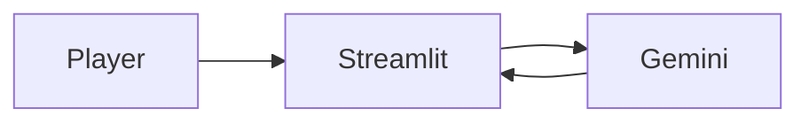
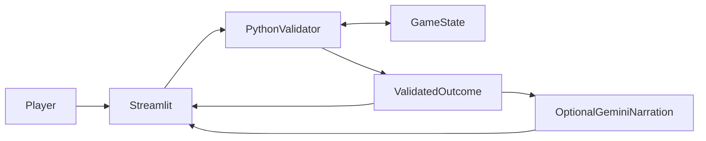

# AI Escape Room — The Locked Library

Python/Streamlit escape room using Gemini. Version 1 lets Gemini run the story; Version 2 validates player actions and tracks inventory in Python.

## Run on Windows

1. Install Python 3.10+.
2. Open this folder in VS Code and open Terminal.
3. `python -m venv .venv`
4. `.venv\Scripts\activate`
5. `python -m pip install -r requirements.txt`
6. Copy `.env.example` to `.env`, then enter your Gemini API key in `.env`. Never share or commit `.env`.
7. `python -m streamlit run version1/app.py`
8. Stop with Ctrl+C; then `python -m streamlit run version2/app.py`.

Version 2 works without an API key, with plain validated game messages. Version 1 needs Gemini access. Change GEMINI_MODEL in .env if the example model is unavailable.

## Architecture — Version 1

## Architecture — Version 2

## Improvements

Version 1 relies on the model to remember items and enforce rules; it may hallucinate objects or unlock doors incorrectly. Version 2 tracks collected keys, visited clues and drawer/door state in Python and rejects invalid actions. Gemini provides optional atmosphere only, and cannot change the state.

## Limitations

Version 2 uses simple keyword parsing and may misinterpret complex language. Optional Gemini narration can still contradict validated outcomes. Future work: schema-validated action parsing and stronger narration filtering.

See `test_cases.md` and `report_template.md`. Add your own screenshots and actual observed test results before submission.
